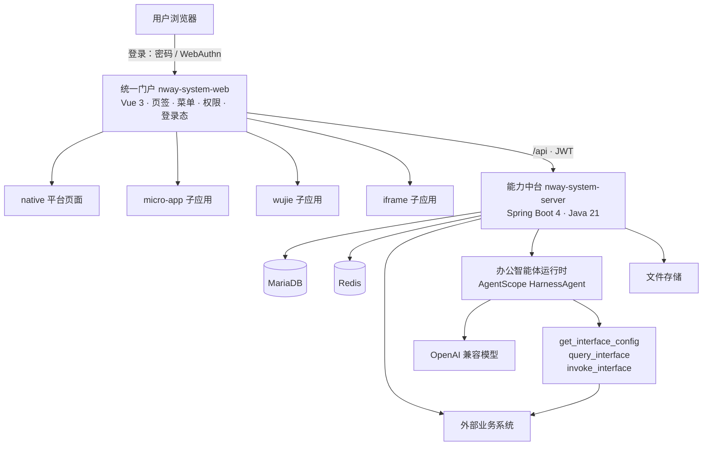

<div align="center">

# nway-system

**一个入口收拢所有系统，一套中台终结重复建设，一个智能体把事真正办成。**

一体化微前端操作平台（micro-app + wujie）· 统一身份（WebAuthn）· 办公智能体

新系统三步接入，不用再写登录、权限和组织；老系统不改一行代码，也能进同一个门户。

**2** 套微前端内核 · **6** 种渲染方式 · **3** 种登录方式 · **4** 维授权模型 · **9** 大中台能力域

<p align="center">
  
  
  
  
  
  
  
  
</p>

[关键技术底座](#关键技术底座) · [核心亮点](#核心亮点) · [技术架构](#技术架构) · [快速开始](#快速开始) · [使用指南](#使用指南) · [贡献指南](#贡献指南)

</div>

---

## 目录

- [项目概述](#项目概述)
- [关键技术底座](#关键技术底座)
- [核心亮点](#核心亮点)
  - [一、原生微前端架构：一个宿主，多种运行时](#一原生微前端架构一个宿主多种运行时)
  - [二、统一身份认证：从密码到本机生物识别](#二统一身份认证从密码到本机生物识别)
  - [三、办公智能体：让 AI 真正把事办成](#三办公智能体让-ai-真正把事办成)
  - [四、企业级中台能力](#四企业级中台能力)
- [技术架构](#技术架构)
- [快速开始](#快速开始)
- [使用指南](#使用指南)
- [项目结构](#项目结构)
- [配置说明](#配置说明)
- [常见问题](#常见问题)
- [贡献指南](#贡献指南)
- [许可证](#许可证)

---

## 项目概述

**nway-system 是一个面向企业内网的一体化操作平台**：一个门户收拢所有系统，一套中台输出所有公共能力，一个办公智能体把"查系统、填表单、走流程"变成一句话。

| 组成 | 定位 | 你得到什么 |
| --- | --- | --- |
| **统一门户**（`nway-system-web`） | 微前端宿主 | 一个入口、一套菜单页签、一次登录，所有系统像同一个产品 |
| **能力中台**（`nway-system-service`） | 企业能力中台 | 身份、组织、权限、租户、字典、消息、文件、审计、开放平台开箱即用 |

### 接入前 vs 接入后


### 它解决的是四笔越拖越贵的工程债

| 工程债 | 症状 | nway-system 的做法 |
| --- | --- | --- |
| **入口分裂** | 员工在十几个系统间反复登录、记密码、找菜单 | 一个门户 + 一次登录 + 统一菜单与页签 |
| **能力重复建设** | 登录、权限、组织、消息、文件被每个团队写 N 遍，标准各不相同 | 中台统一提供，子应用按需调用 |
| **集成方式互不兼容** | 新建的 Vue/React、十年前的 JSP、外部厂商 SaaS 无法用同一方案接入 | 双微前端内核 + 6 种渲染方式，按系统现状选择 |
| **AI 落地没有抓手** | 聊天机器人只会问答，办不了事 | 接口元数据驱动智能体，按用户身份真正调用业务系统 |

### 和常见方案的分工

| 常见方案 | 能解决 | 解决不了 |
| --- | --- | --- |
| 单系统后台框架 | 一个系统的 CRUD、权限、代码生成 | 多系统聚合、遗留系统接入、微前端保活 |
| 只选一套微前端内核 | 现代子应用的集成 | 强隔离与轻量注入需求共存、老系统统一收口 |
| 纯 iframe 门户 | 接入成本低 | 页签保活、路由同步、跨域登录态、体验割裂 |
| 通用 AI 助手 | 问答、总结、文档分析 | 按用户权限真正调用业务系统，并全程留痕 |

### 子应用不用再建的那些东西

| 子应用原本要自己做 | 接入平台后 |
| --- | --- |
| 登录页、Token 存取与续期 | 宿主统一注入 Token，续期 / 登出 / 租户切换统一广播 |
| 菜单、路由、页签 | 平台统一菜单与页签模型，支持页签打开、关闭、重新激活刷新 |
| 按钮级权限、数据范围 | 授权中心 + 鉴权 SDK，前端 `v-permission` 指令直接使用 |
| 组织、人员、岗位查询 | 统一组织接口 |
| 消息、文件、字典 | 中台能力直接调用 |
| 工作台入口、搜索、收藏 | 门户统一提供 |

### 三步接入一个新系统

| 步骤 | 做什么 | 结果 |
| --- | --- | --- |
| ① 建应用 | 填 `appCode`、应用名称、前端地址、租户 | 平台识别这个系统 |
| ② 配菜单 | 填页面地址，选择渲染方式（6 选 1） | 系统出现在门户菜单里 |
| ③ 完成 | 子应用读取宿主注入的 Token | 登录态、权限、页签自动生效 |

> 老系统甚至不需要第 ③ 步：选择 `iFrame` 渲染方式，零改造收进同一套菜单。

### 适合谁

- **系统多、团队多、入口分散**的企业：一次收口，长期受益
- 需要把**遗留系统低成本改造**并统一收口的 IT 部门
- 想把**身份、权限、组织、消息、文件**作为标准能力输出的中台团队
- 希望 **AI 真正接入业务流程**，而不只是做一个问答框的团队

**不适合**：只有一两个系统、没有统一身份诉求的小团队；无法提供 MariaDB / Redis / Nginx 基础运行条件的场景。

### 不是 Demo：几条生产级默认值

- Token 只接受 `Authorization: Bearer`，**不接受 URL 参数**；可信代理之外不采信 `X-Forwarded-For`。
- 权限 **fail-closed**：无租户上下文、无授权、无内部服务令牌时一律拒绝，而非放行。
- AI 写操作**强制人工确认**；模型永远不能传入目标 URL；关键动作全程写入审计日志。
- 不绑定单一技术路线：两套微前端内核、三种登录方式、两个模块许可证，可按需选择。

---

## 关键技术底座

| 技术 | 定位 | 在本项目中的角色 |
| --- | --- | --- |
| [micro-app](https://jd-opensource.github.io/micro-app/) 1.0 | 京东开源微前端框架 | WebComponent + 沙箱渲染、`keep-alive` 应用保活、`keep-router-state` 路由状态保持、iframe 沙箱模式 |
| [wujie](https://wujie-micro.github.io/doc/guide/) 2.1 | 腾讯无界微前端框架 | iframe + Proxy 沙箱、`alive` 多实例保活、无 Proxy 环境自动降级、iframe 降级模式 |
| [WebAuthn](https://www.w3.org/TR/webauthn-3/) | W3C 无密码认证标准（FIDO2） | 调用操作系统平台认证器完成指纹 / 面容验证，私钥与生物特征不出本机 |
| [AgentScope](https://github.com/agentscope-ai/agentscope) 2.1 | 阿里开源 Agent 框架 | HarnessAgent 运行时、工具调用、HITL 人工确认、Redis 会话状态与上下文压缩 |

选择标准不是"技术越新越好"，而是**不让单一技术路线约束业务接入**：

- 微前端同时支持 `micro-app` 与 `wujie` 两套内核，子应用按自身技术栈与隔离需求选择渲染方式；
- 身份认证同时支持本地密码、外部统一身份源与 WebAuthn 生物识别，互不绑定；
- AI 通过接口元数据适配任意业务系统，而不是为每个接口编写专用工具。

---

## 核心亮点

### 一、原生微前端架构：一个宿主，多种运行时

多数微前端方案要求所有子应用统一技术选型、统一构建工具、统一路由模式。nway-system 没有做这个假设。

平台**同时注册并运行两套主流微前端内核**——京东 `micro-app` 与腾讯 `wujie`，并在菜单级别按页面选择渲染方式。同一个宿主中，多个子应用可以同时保活、并行在线；不同年代、不同框架、不同部署方式的系统可以共存于同一套菜单与页签体系。

#### 为什么同时选择 micro-app 与 wujie

两者不是二选一的替代关系，而是互补的隔离模型：

| 维度 | `micro-app` | `wujie` |
| --- | --- | --- |
| 沙箱基础 | WebComponent + 自定义元素 | iframe + Proxy |
| 保活策略 | `keep-alive`，隐藏时挂起全局副作用 | `alive`，实例继续运行 |
| 路由处理 | `keep-router-state` 保持子应用路由状态 | `sync` 与宿主路由同步 |
| 兼容降级 | 提供 iframe 沙箱模式 | 无 Proxy 环境自动降级为 iframe |
| 适合场景 | 追求轻量注入、路由状态保持的业务应用 | 需要强隔离、后台持续运行（定时刷新、消息监听）的应用 |

平台把选择权下放到菜单：同一个门户中，A 系统可以使用 `microApp`，B 系统可以使用 `wujie`，二者共享同一套页签、登录态与权限体系，互不干扰。

#### 六种渲染类型

| 渲染类型 | 隔离方式 | 适用场景 |
| --- | --- | --- |
| `native` | 平台内 Vue 页面 | 平台自建页面，零额外开销 |
| `microApp` | 注入宿主 DOM（WebComponent + 沙箱） | 现代前端应用，需要应用级隔离与保活 |
| `microApp-iframe` | micro-app 的 iframe 沙箱 | 需要强隔离，或运行环境不支持 Proxy |
| `wujie` | 注入宿主 DOM（iframe + Proxy 沙箱） | 现代前端应用，需要后台持续运行 |
| `wujie-iframe` | wujie 降级 iframe | 兼容性优先的接入方式 |
| `iFrame` | 原生 iframe | 任何技术栈的遗留系统，零改造接入 |

#### 渲染器能力矩阵

平台没有把"白屏"留给使用者猜。每种渲染器的能力边界在代码中被显式声明（`src/microfront/capabilities.ts`），加载失败时据此给出可操作的排障建议：

| 渲染类型 | 目标站点禁止被嵌入 | 鉴权通道 | 后台保活 | 无 Proxy 环境 |
| --- | --- | --- | --- | --- |
| `microApp` | 仍可用 | 宿主推送 | 挂起全局副作用 | 需关闭沙箱 |
| `microApp-iframe` | 不可用 | 宿主推送 | 挂起全局副作用 | 可用 |
| `wujie` | 仍可用 | 宿主推送 | 继续运行 | 自动降级 |
| `wujie-iframe` | 不可用 | 宿主推送 | 继续运行 | 可用 |
| `iFrame` | 不可用 | 无 | 继续运行 | 可用 |

> 关键差异：`micro-app` 与 `wujie` 通过"拉取入口 HTML + 注入宿主 DOM"运行，**不受目标站点 `X-Frame-Options` / CSP `frame-ancestors` 限制**；`*-iframe` 与原生 `iFrame` 走真实 iframe，目标站点禁止嵌入时不可用。平台会在加载超时或失败时直接提示"改用 microApp / wujie"，而不是只显示"请稍后重试"。

#### 多实例并行与页签模型

- `micro-app` 使用 `keep-alive` + `keep-router-state`，`wujie` 使用 `alive`，页签切换不销毁子应用实例。
- 平台维护统一的页签状态：打开、切换、关闭、刷新恢复；同一页面重复打开只激活已有页签。
- 子应用可通过统一协议请求宿主**以页签方式打开业务详情页**、**关闭自身页签**、**在来源页签重新激活时刷新数据**，行为与用户点击平台菜单完全一致。
- 页签桥接覆盖四条通道：同源 iframe 全局入口、`wujie` EventBus、`micro-app` globalData、跨域 iframe `postMessage`；非平台环境或宿主未接入时，300ms 内返回 `false`，由子应用自行降级，不阻塞用户操作。

#### 统一登录态注入

子应用不需要自己实现登录页，也不需要把 Token 拼进 URL：

| 承载方式 | 登录态获取 | 运行时同步 |
| --- | --- | --- |
| `micro-app` | `window.microApp.getData()` 读取 `token` / `user` | 宿主按应用名 `setData` 精确投递 |
| `wujie` | `window.$wujie.props` 读取 `token` / `user` | 实例级 `nway:auth-change:<appName>` + 全局 `nway:auth-change` |
| `iframe` | `nway:auth-request` / `nway:auth` 握手 | `postMessage` |
| 跨域跳转 | 一次性 `ds_token` 参数，子应用读取后立即从地址栏移除 | — |

Token 滑动续期、登出、切换工作租户都由宿主统一广播，子应用只需订阅并更新本地 `sessionStorage` 中的 `ds-token`。

#### 工程化细节

真正让多内核长期稳定共存的，是一批不起眼但关键的修复：

- `micro-app` 使用 `router-mode="state"`，避免子应用虚拟路由污染宿主地址栏；
- 沙箱 `iframeSrc` 指向同源空白页，防止沙箱重复加载宿主应用、产生伪路由参数导致白屏；
- 为 `wujie-vue3` 补齐 Vue 3 下的卸载收尾逻辑；
- 路由守卫自动清理 `micro-app` 遗留的脏查询参数，让已白屏的 URL 可以自愈；
- 生产构建将 Vue、Element Plus、微前端运行时、工具库拆分为独立 chunk，避免单包过大。

---

### 二、统一身份认证：从密码到本机生物识别

平台把"登录"抽象为可扩展的认证策略，而不是写死在登录接口里的 if/else。

#### 多认证源并存

| 认证方式 | 说明 |
| --- | --- |
| 账号密码 | 平台本地 BCrypt 校验；密码策略、过期强制改密、首次登录改密 |
| 外部身份源 | 可对接企业统一身份认证；外部校验通过但本地无账号时自动补建影子账号，并保留本地管理员回退入口 |
| 生物识别 | 基于 WebAuthn 平台认证器的本机指纹 / 面容登录，与账号密码身份源解耦 |

#### 生物识别登录

这不是"记住密码"，也不是简单的本地开关，而是调用**操作系统原生的平台认证器**（Windows Hello、Touch ID、Face ID 等）完成本机身份确认：

```text
登录页
  └─ client.authenticate({ challenge })
       └─ 操作系统平台认证器（指纹 / 面容）
            └─ 返回 credentialId（生物特征与私钥不出本机）
                 └─ POST /login { loginType: "bio", clientType: "pc", key: credentialId }
                      └─ BioAuthorization：按 PC / 移动端凭证映射用户
                           └─ 签发平台 JWT
```

#### 为什么是 WebAuthn

- **标准化**：W3C WebAuthn（FIDO2）由浏览器与操作系统共同实现，不依赖特定硬件厂商。
- **本机验证**：指纹 / 面容数据与私钥通常由 TPM、Secure Enclave 等安全硬件保管，平台只接收凭证 ID。
- **抗钓鱼**：凭证与站点来源（RP ID）绑定，仿冒域名无法复用。
- **系统级体验**：直接复用 Windows Hello、Touch ID、Face ID 等系统能力，无需安装额外应用。
- **可降级**：设备不支持或验证失败时，可随时切换账号密码，不阻断登录。

设计要点：

- **与身份源解耦**：即使账号密码走外部统一身份认证，生物识别仍校验平台本地凭证（`sys_user_login_key.bio_pc` / `bio_mobile`），互不影响。
- **PC / 移动端分离**：同一用户可为不同终端绑定不同凭证。
- **体验优先**：检测到本地已绑定凭证且设备支持时，登录页自动进入生物识别模式并尝试登录；失败静默处理，用户可随时切换到账号密码。
- **安全上下文**：WebAuthn 要求 HTTPS 或 `localhost`，生产环境需启用 HTTPS。

#### JWT 会话与权限模型

- JWT 使用 HMAC-SHA 签名（算法随密钥长度自动选择 HS256/HS384/HS512），默认有效期 24 小时。
- 剩余不足 5 分钟可滑动续期，单 Token 最多续期 30 次，会话总时长上限约 30 天。
- Token 只接受请求头 `Authorization: Bearer <token>`，**不接受 URL 参数**；可信代理之外不采信 `X-Forwarded-For`。
- 权限模型为「资源目录 + 统一授权」：支持 `ROLE` / `USER` / `POSITION` / `APP` 四种授权维度，授权项包含 `actions`、`effect` 与 `data_scope`。
- 授权变更通过版本号（`sys_authz_version`）失效缓存，`sys_grant_change` 全程留痕。
- 提供独立鉴权 SDK（`nway-system-authz-sdk`），外部系统可复用同一套功能权限与数据权限判断。

---

### 三、办公智能体：让 AI 真正把事办成

平台内置的不是"一个会聊天的输入框"，而是一个**能理解业务、能调用系统接口、能完成办理**的办公智能体。

#### 核心设计：业务接口是数据，不是工具

传统做法是给每个 API 写一个 Function Calling 工具，接口一多就不可维护。nway-system 的选择是：

> **把业务接口抽象为可配置的元数据，Agent 核心工具保持精简。**

```json
{
  "interfaceCode": "oa.leave.apply",
  "name": "提交请假申请",
  "description": "为当前员工发起请假流程，需提供请假类型、开始时间、结束时间与事由",
  "appCode": "oa-system",
  "httpMethod": "POST",
  "path": "/leave/apply",
  "riskLevel": "WRITE",
  "confirmRequired": true,
  "inputSchema": [
    { "key": "leaveType", "label": "请假类型", "type": "STRING", "required": true },
    { "key": "startTime", "label": "开始时间", "type": "DATETIME", "required": true },
    { "key": "endTime", "label": "结束时间", "type": "DATETIME", "required": true },
    { "key": "reason", "label": "事由", "type": "STRING", "required": true }
  ],
  "outputSchema": [
    { "key": "applyNo", "label": "申请单号", "type": "STRING" },
    { "key": "status", "label": "流程状态", "type": "STRING" }
  ],
  "searchKeywords": "请假,休假,年假,调休,事假",
  "examples": ["帮我请明天一天年假", "下周一上午请假两小时"]
}
```

接入一个新业务能力，通常只需要在管理端配置一条接口元数据并发布，**不需要改代码、不需要重新部署 Agent**。

#### 核心工具

| 工具 | 职责 |
| --- | --- |
| `get_interface_config` | 按用户原话检索已发布接口，返回 `inputSchema`、必填项、候选值与置信度 |
| `query_interface` | 只读查询直返：调用结果直接作为本轮答复展示给用户，跳过模型转述 |
| `invoke_interface` | 通用调用：结果返回模型继续处理，用于分析、多次调用与写操作（写操作需用户确认） |

`query_interface` 与 `invoke_interface` 由模型按用户意图选择：单纯查看数据走直返；用户要求分析、对比、总结，或需要基于结果继续调用接口时走通用调用。接口返回的数据保持原样，默认不触发模型的统计分析；只有用户明确要求分析时才由模型处理。

按需还可启用两个可选工具：

- `lookup_options`：字段配置了候选值来源时，按关键词查询候选（如部门、项目、请假类型）。
- `read_file`：按 `fileId` 解析 Word / Excel / PPT / PDF 等附件文本。

#### 两级接口检索

面对几十上百个业务接口，单纯的关键词匹配并不可靠。平台采用两级检索：

1. **规则召回**：字段加权、IDF、中文二元组、同义词归一化（员工/人员/用户）、问句噪声剥离（"帮我查一下…"）、写操作动词与 `riskLevel` 对齐。
2. **语义路由**：当规则最高分低于阈值（0.50）时，调用大模型在「当前用户可见的接口目录」中做语义排序；超时 3 秒自动回退规则结果。

模型**只参与排序，不参与执行**。候选结果仍要经过发布态、租户与接口权限过滤，低置信度时 Agent 会先向用户确认业务对象，而不是猜测调用。

#### 一次办理的完整链路

```text
用户提问 / 上传附件
  └─ POST /nway-system/ai/chat/stream（SSE 流式）
       └─ HarnessAgent（AgentScope 2.1）
            ├─ 意图判断：业务查询 / 文件分析 / 组合场景
            ├─ get_interface_config：两级检索 + 权限过滤
            ├─ 参数校验：inputSchema、必填项、枚举候选、附件归属
            ├─ 写操作 → HITL（Human-in-the-loop）确认表单 → 用户确认 → 后端重新校验后执行
            ├─ query_interface / invoke_interface：透传用户 JWT 调用业务系统
            ├─ 直返查询：结果直接作为本轮答复返回，跳过模型转述
            ├─ outputSchema 约束：只允许引用已定义字段
            └─ 审计留痕（sys_audit_log）
  └─ 接口结果卡片 / Markdown + nway-view 结构化渲染
```

#### 安全边界

让 AI 操作系统接口，最怕的是"越权"和"误操作"。平台的控制点是分层的：

| 风险 | 控制手段 |
| --- | --- |
| 越权访问 | 用户上下文 + 接口级授权 + 数据范围；调用时透传用户 JWT，目标系统仍按本人权限校验 |
| 误提交、误删除 | `riskLevel`（READ / WRITE / HIGH_RISK）+ `confirmRequired`；写操作强制 HITL 用户确认 |
| 参数幻觉 | 严格按 `inputSchema` 校验；缺少必填信息先追问，不允许猜测 |
| 结果编造 | `outputSchema` 约束回答字段；工具报错时如实说明，不得伪造成功 |
| SSRF / 任意 URL | 目标地址只能来自字典 `ai_app_code` 或受控配置，模型**永远不能传入 URL** |
| 密钥泄露 | 模型 API Key 使用 AES-GCM 加密存储，主密钥由环境变量注入 |
| 无限循环 | Agent 最大迭代 12 轮；禁用 Shell、Web、子代理、文件系统与动态技能工具 |
| 长结果污染上下文 | invoke_interface 结果超过 8000 字符自动截断；query_interface 直返结果不经模型、完整展示；会话超过 30 条消息触发上下文压缩 |

#### 交互体验

- **SSE 流式输出**：思考过程、工具调用卡片、正文分阶段呈现。
- **结构化渲染**：正文中输出 `nway-view` 代码块，前端自动渲染为表格、指标卡、柱状/折线/饼图、详情字段、清单或文件列表。
- **附件理解**：拖拽上传（最多 5 个，单个不超过 20MB），图片直接进行视觉分析，文档按需提取文本。
- **多轮会话**：会话历史持久化，标题自动生成，支持归档。
- **可插拔模型**：兼容 OpenAI 协议模型，管理端可配置默认模型与语义路由专用模型。

---

### 四、企业级中台能力

| 能力域 | 说明 |
| --- | --- |
| 组织与用户 | 用户、部门、岗位、角色、用户角色与部门关系维护 |
| 统一授权 | 资源目录、按钮级权限、功能权限、数据范围、授权变更留痕与版本失效 |
| 多租户 | `tenant_code` 数据隔离、平台管理员跨租户授权、租户级 QPS 配额 |
| 开放平台 | OAuth2 风格 Token（`client_credentials` / `user_delegate` / `authorization_code`）、SSO、限流、IP 白名单、Webhook |
| 菜单与应用 | 应用注册、菜单管理、子应用接入、低代码表单菜单同步、菜单自注册 |
| 文件中心 | 上传、下载、预览、短时票据、HTTP Range 视频预览；本地存储，S3/MinIO 预留 |
| 消息中心 | 站内消息、邮件、企业微信；按用户 / 部门 / 角色定向发送 |
| 审计与监控 | 操作审计、开放接口调用日志、在线用户、Actuator 健康检查与运行指标 |
| 基础配置 | 数据字典、系统参数、登录安全策略 |

---

## 技术架构



### 技术栈

| 层次 | 技术 |
| --- | --- |
| 前端框架 | Vue 3.5、TypeScript 6、Vite 8、Pinia 4、Vue Router 5 |
| UI | Element Plus 2.14、Sass、Element Plus Icons |
| 微前端 | [`@micro-zoe/micro-app`](https://jd-opensource.github.io/micro-app/) 1.0.0-rc.32、[`wujie-vue3`](https://wujie-micro.github.io/doc/guide/) 2.1 |
| 生物识别 | [`@passwordless-id/webauthn`](https://github.com/passwordless-id/webauthn) 2.4（WebAuthn / FIDO2） |
| 后端 | Spring Boot 4.1、Java 21、Maven 多模块、Druid、Spring Data Redis、Caffeine、jjwt 0.12、BCrypt |
| 数据访问 | [nway-jdbc](https://github.com/zdtjss/nway-jdbc) 1.7（自研单表 ORM） |
| AI 运行时 | AgentScope HarnessAgent 2.1.0-BETA1、OpenAI 兼容模型扩展、Redis / JDBC 状态存储 |
| 文档解析 | Apache POI 6、PDFBox 3 |
| 基础设施 | MariaDB、Redis、Nginx、Docker |

### 关键设计决策

| 决策 | 原因 |
| --- | --- |
| 双微前端内核共存 | 不强制子应用统一技术选型；不同接入场景选择不同隔离与保活策略 |
| 渲染器能力显式声明 | 把"为什么白屏"变成可诊断、可操作的问题，而不是黑盒 |
| 登录态由宿主统一注入 | 子应用不接触登录流程，续期、登出、租户切换天然一致 |
| 接口元数据驱动 AI | 新增业务能力不写代码、不发版，避免工具数量随接口线性膨胀 |
| 写操作强制人工确认 | AI 可以准备和发起，但关键动作必须由人确认 |
| 权限 fail-closed | 无租户上下文、无授权、无内部服务令牌时一律拒绝，而非放行 |
| 前后端分离 + 多阶段镜像 | 前端由 Nginx 托管并反向代理后端，后端以 JRE 镜像独立部署 |

---

## 快速开始

### 最短启动路径

前提：JDK 21、Maven 3.9+、Node 20+、MariaDB、Redis 已就绪，库表已按下方第 2 步初始化。

```bash
# 1. 后端（http://localhost:9081/nway-system）
cd nway-system-service
mvn -pl nway-system-server -am clean package -DskipTests
java -jar nway-system-server/target/nway-system-server-1.0.0.jar --spring.profiles.active=local

# 2. 前端（另开终端，http://localhost:5173）
cd nway-system-web
npm install
npm run dev
```

用 `admin / 1` 登录后，可依次体验：菜单页签 → 应用管理 → 权限工作台 → AI 对话。

### 环境要求

| 依赖 | 版本要求 |
| --- | --- |
| JDK | 21 |
| Maven | 3.9+ |
| Node.js | 20.19+（推荐 22 LTS） |
| MariaDB | 10.11+ |
| Redis | 7+ |
| 浏览器 | 支持 WebAuthn 的现代浏览器（生物识别需 HTTPS 或 localhost） |

### 1. 获取代码

```bash
git clone <repository-url> nway-system
cd nway-system
```

### 2. 初始化数据库

```sql
CREATE DATABASE nway_system
  DEFAULT CHARACTER SET utf8mb4
  COLLATE utf8mb4_general_ci;
```

按文件名顺序执行 `nway-system-service/db/` 下的场景脚本（详细覆盖范围与依赖见 [db/README.md](nway-system-service/db/README.md)）：

| 脚本 | 业务场景 | 内容 | 是否必需 |
| --- | --- | --- | --- |
| `01_platform_tenant_app.sql` | 平台基座 | 租户、应用；default/public 租户与系统管理应用 | 必需 |
| `02_permission_authz.sql` | 权限与导航 | 角色、用户角色、菜单、收藏、管理员授权、资源、统一授权、视图；管理员角色与平台导航基线 | 必需 |
| `03_organization.sql` | 组织架构 | 部门、跨部门任职、岗位、用户岗位 | 必需 |
| `04_identity_user.sql` | 用户身份 | 用户、登录校验；默认管理员账号 | 必需 |
| `05_dict_config.sql` | 字典与配置 | 字典类别 / 字典项、系统配置 | 必需 |
| `06_message_center.sql` | 消息中心 | 消息主表 / 目标 / 接收人 / 发送日志 | 必需 |
| `07_file_center.sql` | 文件中心 | 文件元数据 | 使用文件能力时必需 |
| `08_open_platform.sql` | 开放平台 | 开放应用 / Webhook / 调用日志 | 使用开放平台时必需 |
| `09_audit_log.sql` | 审计日志 | 审计日志表 | 必需（审计能力） |
| `10_oa_bpm_integration.sql` | OA / BPM 集成 | OA 租户与 BPM 流程菜单 | 可选 |
| `11_ai_office_agent.sql` | 办公智能体 | AI 接口 / 模型 / 提示词 / 会话 / 消息、授权分组、菜单、应用字典 | 使用 AI 时必需 |

Bash 环境可一次执行全部必需脚本：

```bash
cd nway-system-service
for f in db/[0-9][0-9]_*.sql; do
  mysql -h 127.0.0.1 -u root -p nway_system < "$f"
done
```

可选演示数据（集团组织架构、岗位职级字典）在必需脚本之后执行：

```bash
mysql -h 127.0.0.1 -u root -p nway_system < db/demo/01_organization_demo.sql
mysql -h 127.0.0.1 -u root -p nway_system < db/demo/02_dict_demo.sql
```

> **注意**
> - `system.sql` 是早期基线脚本，字段已过时，**不要用于新环境初始化**。
> - 初始化会创建默认账号 `admin`，初始密码 `1`，首次登录后请立即修改。
> - 所有场景脚本按「先 DDL、后 DML」组织，依赖顺序为 `01 → 02 → 03 → 04 → 05 → 06 → 07 → 08 → 09 → 10 → 11`。
> - Windows 用户可使用 `cmd /c "mysql ... < 脚本路径"` 按文件名顺序执行，或在 MySQL 客户端中依次执行。

### 3. 启动后端

修改 `nway-system-service/nway-system-server/src/main/resources/application-local.yml` 中的数据库与 Redis 地址，或用环境变量覆盖：

```yaml
spring:
  datasource:
    druid:
      url: jdbc:mariadb://127.0.0.1:3306/nway_system?useUnicode=true&characterEncoding=UTF-8&useSSL=false
      username: nway_system
      password: <your-password>
  data:
    redis:
      host: 127.0.0.1
```

编译并启动：

```bash
cd nway-system-service
mvn -pl nway-system-server -am clean package -DskipTests
java -jar nway-system-server/target/nway-system-server-1.0.0.jar --spring.profiles.active=local
```

本地默认地址：

- 服务端口：`9081`（`application.yml` 默认 `8081`，`local` profile 覆盖为 `9081`）
- 上下文路径：`/nway-system`
- 健康检查：<http://localhost:9081/nway-system/actuator/health>

### 4. 启动前端

```bash
cd nway-system-web
npm install
npm run dev
```

访问 <http://localhost:5173>，使用 `admin / 1` 登录。

开发服务器会把 `/api` 代理到 `http://localhost:9081` 并移除 `/api` 前缀，配合 `VITE_API_URL=/api/nway-system` 命中后端上下文路径。

常用命令：

```bash
npm run dev         # 开发服务器
npm run build       # 类型检查 + 生产构建（产物在 dist/）
npm run preview     # 预览生产构建
npm run type-check  # 仅类型检查
npm run lint        # ESLint 检查并修复
npm run format      # Prettier 格式化 src/
```

### 5. Docker 部署

```bash
# 后端（在 nway-system-service 目录执行）
docker build -t nway-system-service .

# 前端（在 nway-system-web 目录执行）
docker build -t nway-system-web .
```

后端容器使用 `docker` profile，需注入数据源与 Redis 环境变量：

```bash
docker run -d --name nway-system-service \
  -e SPRING_DATASOURCE_URL='jdbc:mariadb://mariadb:3306/nway_system' \
  -e SPRING_DATASOURCE_USERNAME=nway_system \
  -e SPRING_DATASOURCE_PASSWORD=<password> \
  -e SPRING_DATA_REDIS_HOST=redis \
  -e JWT_SECRET=<at-least-32-characters> \
  -e AI_CRYPTO_KEY=<your-ai-master-key> \
  -p 8081:8081 nway-system-service
```

前端 Nginx 镜像默认把 `/nway-system` 与 `/api` 反向代理到 `nway-system-service:8081`。

---

## 使用指南

### 接入一个子应用

| 步骤 | 操作 |
| --- | --- |
| 1. 创建应用 | 「系统管理 → 应用管理」填写 `appCode`、应用名称、前端地址（`host`）、租户归属 |
| 2. 创建菜单 | 「菜单管理」创建菜单并归属该应用；页面类型选 `PAGE`，填写子应用地址 |
| 3. 选择渲染方式 | 按子应用技术栈与部署条件选择 `microApp` / `microApp-iframe` / `wujie` / `wujie-iframe` / `iFrame` |
| 4. 获取登录态 | 子应用按承载方式读取 Token，统一写入 `sessionStorage` 的 `ds-token` |

子应用请求示例：

```js
// micro-app
const { token, user } = window.microApp.getData()

// wujie
const { token, user, appName } = window.$wujie.props

// iframe：发送握手请求
window.parent.postMessage({ type: 'nway:auth-request' }, '*')
window.addEventListener('message', (e) => {
  if (e.data && e.data.type === 'nway:auth') {
    sessionStorage.setItem('ds-token', e.data.token)
  }
})
```

请求平台接口：

```http
Authorization: Bearer <token>
```

> Token 续期与登出由宿主统一广播，子应用不要自行续期，也不要把 Token 放进 URL。

### 在平台内以页签打开详情页

子应用点击业务单据时，可请求宿主以页签方式打开目标页面，全程不新开浏览器标签：

```js
import { openPageInHost } from '@/utils/openInHost'

const opened = await openPageInHost({
  name: row.subject || row.no || '详情',
  url: row.detailsUrl // 必须是 http(s) 完整地址
})

if (!opened) {
  // 非平台环境或宿主未接入：自行降级（如应用内 iframe 页签）
}
```

关闭页签与页签重新激活刷新：

```js
import { closePage } from '@/utils/closePage'

await closePage(() => router.replace('/list'))
```

完整协议、四条通道、回执格式与可复制代码见 [子应用页签打开能力](nway-system-web/docs/子应用页签打开能力.md)。

### 开放平台调用

获取开放 Token：

```bash
curl -X POST 'http://localhost:9081/nway-system/open/token' \
  -H 'Content-Type: application/x-www-form-urlencoded' \
  -d 'appCode=oa-system' \
  -d 'appSecret=<appSecret>' \
  -d 'grantType=client_credentials'
```

调用开放接口：

```bash
curl 'http://localhost:9081/nway-system/open/user/getByEmployeeId?employeeId=EMP001' \
  -H 'Authorization: Bearer <access_token>'
```

说明：

- 开放 Token 默认有效期 2 小时，只能调用 `/open/*` 接口。
- 用户 JWT 与开放 Token 互不通用。
- 应用身份只以 Token 为准，`X-App-Code` 请求头已废弃。
- 支持 `client_credentials`、`user_delegate`、`authorization_code` 三种授权模式。

完整能力清单与 scope 说明见 [外部系统对接文档](nway-system-service/docs/外部系统对接文档.md)。

### 接入 AI 业务接口

1. 在「平台配置 → AI 接口配置」新增接口元数据：填写 `interfaceCode`、`appCode`、HTTP 方法、路径、风险等级、入参 / 出参 Schema、检索关键词与用户表达示例。
2. 为接口配置目标应用的后端基础地址（字典 `ai_app_code` 中的 `baseUrl`）。
3. 发布接口，并在「权限工作台」为角色 / 用户 / 岗位 / 应用授予调用权限。
4. 在「办公智能体 → AI 对话」中直接提问，或上传附件后让智能体提取信息并办理。

> 接口描述与关键词直接决定检索质量。建议用"业务场景 + 动作"描述，并补充用户常用口语（如"请假"、"休假"、"调休"）。

### 文件中心

```bash
# 上传
curl -X POST 'http://localhost:9081/nway-system/file/upload' \
  -H 'Authorization: Bearer <token>' \
  -F 'file=@demo.pdf' \
  -F 'bizType=contract' \
  -F 'bizId=1001'

# 下载
curl -OJ 'http://localhost:9081/nway-system/file/download/<fileId>' \
  -H 'Authorization: Bearer <token>'
```

其他端点：`/file/queryPage`、`/file/getById`、`/file/preview/{id}`、`/file/ticket`、`/file/ticketDownload`、`/file/delete`。

前端可直接使用内置 SDK：

```ts
import { FileUpload, FilePreview } from '@nway/file/vue'
```

详见 [文件管理对接文档](nway-system-service/docs/文件管理对接文档.md) 与 [文件上传与预览](nway-system-web/docs/文件上传与预览.md)。

### 文档索引

| 文档 | 内容 |
| --- | --- |
| [外部系统接入身份认证文档](nway-system-service/docs/外部系统接入身份认证文档.md) | 用户登录、JWT 签发 / 校验 / 续期、登录安全策略、开放平台 Token 与 SSO |
| [外部系统对接文档](nway-system-service/docs/外部系统对接文档.md) | 应用注册、授权模式、开放 API、菜单自注册、低代码菜单同步、Webhook |
| [文件管理对接文档](nway-system-service/docs/文件管理对接文档.md) | 文件接口、存储、短时票据、`/open/file/**` 与配置 |
| [文件上传与预览](nway-system-web/docs/文件上传与预览.md) | `@nway/file` SDK、上传校验、进度 / 取消 / 重试、PDF 预览 |
| [子应用页签打开能力](nway-system-web/docs/子应用页签打开能力.md) | 页签打开 / 关闭 / 重新激活刷新、四通道协议与示例代码 |

---

## 项目结构

```text
nway-system/
├── nway-system-service/                  # 后端 Maven 多模块工程
│   ├── nway-system-server/               # 唯一可部署应用：启动、装配、HTTP 适配、打包
│   │   └── src/main/java/com/nway/system/
│   │       ├── config/                   # 启动配置、拦截器、全局异常
│   │       ├── common/                   # 技术底座：web / security / tenant / persistence / event / util
│   │       ├── identity/                 # 登录认证、用户、部门、岗位、角色
│   │       ├── authorization/            # 资源目录、统一授权、策略、数据范围
│   │       ├── tenant/                   # 租户与管理员跨租户授权
│   │       ├── portal/                   # 菜单、应用、收藏、低代码菜单同步
│   │       ├── message/                  # 消息中心
│   │       ├── file/                     # 文件中心
│   │       ├── metadata/                 # 字典与系统配置
│   │       ├── openplatform/             # 开放平台与 /open/**
│   │       ├── audit/                    # 审计
│   │       └── ai/                       # 办公智能体：Agent、工具、检索、调用器、SSE
│   ├── nway-system-message-api/          # 消息发送契约（按 Java 8 编译）
│   ├── nway-system-authz-sdk/            # 对外鉴权 SDK（功能权限 + 数据权限）
│   ├── db/                               # 建库脚本 01~12（必需）+ 20~30（可选 / AI）
│   ├── docs/                             # 开放平台、身份认证、文件管理对接文档
│   ├── Dockerfile                        # 后端多阶段构建
│   └── pom.xml
├── nway-system-web/                      # 前端 Vue 3 工程
│   ├── packages/file/                    # @nway/file 文件中心前端 SDK
│   ├── docs/                             # 子应用页签、文件上传与预览
│   ├── public/empty.html                 # micro-app 沙箱同源空白页
│   ├── src/
│   │   ├── api/                          # 按模块拆分的接口封装
│   │   ├── components/                   # 通用组件、AI 渲染组件、全局搜索
│   │   ├── directives/                   # 按钮级权限指令
│   │   ├── js/                           # 请求代理、鉴权、子应用桥接
│   │   ├── microfront/                   # 渲染器能力声明、wujie 生命周期修复
│   │   ├── router/                       # 静态路由与登录守卫
│   │   ├── stores/                       # Pinia：菜单页签、iframe 应用、AI 会话
│   │   ├── views/                        # 登录、布局、系统管理、AI 对话
│   │   ├── App.vue                       # 子应用桥接安装、全局搜索
│   │   └── main.ts                       # micro-app / wujie 双内核启动
│   ├── Dockerfile                        # 前端构建 + Nginx 镜像
│   └── package.json
└── README.md
```

---

## 配置说明

### 配置文件

| 文件 | 用途 |
| --- | --- |
| `application.yml` | 公共配置：端口、JWT、文件、消息、AI、Actuator |
| `application-local.yml` | 本地开发：数据库、Redis、AI 工作目录 |
| `application-test.yml` | 测试环境 |
| `application-docker.yml` | 容器部署：数据源与 Redis 全部通过环境变量注入 |

### 常用环境变量

| 变量 | 说明 |
| --- | --- |
| `JWT_SECRET` | 用户 JWT 签名密钥，至少 32 字符，生产必须覆盖 |
| `JWT_OPEN_SECRET` | 开放平台独立签名密钥；为空时降级使用 `JWT_SECRET` |
| `JWT_EXPIRE_MILLIS` | Token 有效期，默认 `86400000`（24 小时） |
| `JWT_REFRESH_THRESHOLD_MILLIS` | 续期阈值，默认 `300000`（5 分钟） |
| `JWT_MAX_REFRESH_COUNT` | 单 Token 最大续期次数，默认 `30` |
| `SPRING_DATASOURCE_URL` / `SPRING_DATASOURCE_USERNAME` / `SPRING_DATASOURCE_PASSWORD` | 容器部署数据源 |
| `SPRING_DATA_REDIS_HOST` / `SPRING_DATA_REDIS_PASSWORD` | Redis 连接 |
| `EXTERNAL_AUTH_ENABLED` / `EXTERNAL_AUTH_BASE_URL` | 外部统一身份认证开关与地址 |
| `EXTERNAL_AUTH_TENANT_CODE` | 外部用户落地租户 |
| `FILE_STORAGE_TYPE` / `FILE_STORAGE_ROOT` | 文件存储类型与本地根目录 |
| `AI_CRYPTO_KEY` | AI 模型 API Key 的 AES-GCM 主密钥，生产必须配置 |
| `AI_WORKSPACE` | Agent 工作目录，多实例部署时需挂共享卷或独立目录 |
| `AI_SEARCH_LLM_ROUTING_ENABLED` | 是否启用大模型语义路由，默认 `true` |
| `AI_READ_FILE_ENABLED` | 是否允许智能体读取对话附件，默认 `true` |
| `TRUSTED_PROXIES` | 可信反向代理地址，命中才采信 `X-Forwarded-For` |

### 关键配置项

| 配置项 | 默认值 | 说明 |
| --- | --- | --- |
| `server.port` | `8081`（local：`9081`） | 服务端口 |
| `server.servlet.context-path` | `/nway-system` | 所有接口统一前缀 |
| `nway.tenant.quota.internal-qps` | `1000` | 单租户内部接口 QPS 上限，`<=0` 不限制 |
| `nway.file.max-size` | `209715200` | 文件业务上限（200 MB） |
| `nway.file.ticket-ttl-seconds` | `600` | 下载 / 预览票据有效期 |
| `nway.ai.workspace` | `./data/ai-workspace` | Agent 工作目录 |
| `nway.ai.search.llm-routing-timeout-ms` | `3000` | 语义路由超时，超时回退规则检索 |
| `spring.servlet.multipart.max-file-size` | `200MB` | 单文件上传上限 |
| `management.endpoints.web.exposure.include` | `health,info,metrics` | Actuator 暴露端点 |

> **生产部署必改**：`admin` 初始密码、`JWT_SECRET`、`JWT_OPEN_SECRET`、`AI_CRYPTO_KEY`、数据库与 Redis 密码。生产环境建议设置 `EXTERNAL_AUTH_LOCAL_FALLBACK=false`，关闭外部认证失败后的本地密码回退。

---

## 常见问题

**子应用白屏，控制台提示加载失败？**

先确认目标站点是否允许被嵌入。若响应头包含 `X-Frame-Options: DENY/SAMEORIGIN` 或 CSP `frame-ancestors`，使用 `iFrame` / `*-iframe` 渲染方式会失败，请把菜单渲染类型改为 `microApp` 或 `wujie`；同时确认目标站点已放行平台域名的跨域请求与静态资源访问。

**生物识别选项不可用？**

WebAuthn 需要浏览器与操作系统支持平台认证器，且页面运行在 HTTPS 或 `localhost` 下。设备未绑定指纹 / 面容、浏览器不支持、或使用非安全上下文时，请使用账号密码登录。

**智能体找不到我要的接口？**

依次检查：接口是否已发布、当前用户是否被授予接口权限、租户是否匹配、接口描述与检索关键词是否覆盖用户口语。规则检索置信度不足时会触发语义路由，但元数据质量仍是最关键因素。

**子应用请求返回 401？**

确认 Token 来自宿主注入并写入 `sessionStorage` 的 `ds-token`，请求头使用 `Authorization: Bearer <token>`。子应用不要自行续期；续期与登出由宿主广播，收到 `nway:auth-change` 后更新本地 Token。

**页面刷新后 micro-app 子应用白屏？**

平台已使用 `router-mode="state"` 并将沙箱 `iframeSrc` 指向同源空白页来规避该问题。若仍有历史脏参数，路由守卫会自动清理以 `app_` 开头且值等于宿主路径的查询参数。

---

## 贡献指南

我们欢迎任何形式的贡献：缺陷修复、能力增强、文档完善、接入案例。

### 工作流

1. Fork 仓库并创建分支：`feat/xxx`、`fix/xxx`、`docs/xxx`。
2. 保持改动聚焦，一个 PR 只做一件事。
3. 提交前完成本地校验。
4. 提交 PR，说明背景、方案、影响范围与验证方式。

### 提交前校验

前端：

```bash
cd nway-system-web
npm run type-check
npm run lint
npm run build
```

后端：

```bash
cd nway-system-service
mvn -pl nway-system-server -am clean package
```

### 约定

- **提交信息**：遵循 Conventional Commits，如 `feat(ai): 支持按附件内容检索接口`、`fix(web): 修复页签关闭后未刷新来源页`。
- **数据库脚本**：新增脚本按序号递增，不修改已在环境中执行过的脚本；脚本需可重复执行或明确说明执行前提。
- **接口变更**：同步更新 `docs/` 下对应文档与前端接口封装。
- **子应用协议**：修改页签 / 鉴权事件名或载荷时，必须同时更新 `openInHost.js`、`closePage.js`、`subAppBridge.js`、`current.vue` 与文档。
- **安全**：不要在代码、日志、示例中提交真实密钥、Token、账号密码或生产地址。

### 提交 PR 前检查

- [ ] 改动可编译、可通过类型检查
- [ ] 新增逻辑有必要的注释与边界处理
- [ ] 涉及权限、租户、审计的改动已做 fail-closed 校验
- [ ] 文档与代码保持一致
- [ ] 未提交无关文件、构建产物或本地配置

---

## 许可证

本项目按模块采用不同许可证：

| 模块 | 许可证 | 文件 |
| --- | --- | --- |
| `nway-system-service`（后端） | Apache License 2.0 | [LICENSE](nway-system-service/LICENSE) |
| `nway-system-web`（前端） | MIT License | [LICENSE](nway-system-web/LICENSE) |

使用或分发前请阅读对应模块的 LICENSE 文件。

---

<div align="center">

**技术无界，平台有为。**

如果这个项目对你有帮助，欢迎 Star、Issue 与 PR。

</div>
